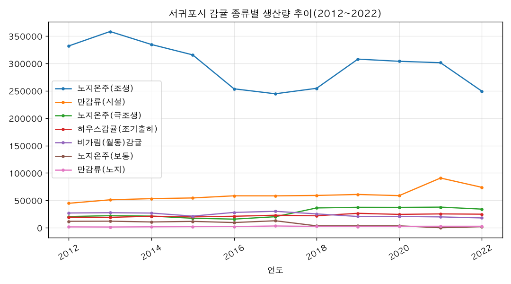

# 서귀포시 감귤 종류별로 생산량이 어떻게 변해왔어?

## 핵심 답
서귀포시 감귤 생산량은 **노지온주(조생)가 여전히 가장 많지만 10년 새 25% 줄었고, 만감류(시설)가 65% 늘어** 품목 구성이 바뀌고 있습니다. 전체 생산량은 2012년 45만6,365 → 2022년 40만4,233으로 약 11% 감소했습니다.

## 근거 (연도별 생산량, 단위는 원자료 기준)

| 종류 | 2012년 | 2022년 | 10년 증감률 |
|---|---|---|---|
| 노지온주(조생) | 331,925 | 249,337.61 | **-24.9%** |
| 만감류(시설) | 44,647 | 73,789.54 | **+65.3%** |
| 노지온주(극조생) | 20,363 | 33,968.52 | +66.8% |
| 하우스감귤(조기출하) | 19,273 | 24,724.7 | +28.3% |
| 비가림(월동)감귤 | 26,911 | 17,880.02 | -33.6% |
| 만감류(노지) | 1,489 | 2,654.82 | +78.3% |
| 노지온주(보통) | 11,757 | 1,878.16 | -84.0% |

## 해석
- **조생 온주 중심 → 만감류·극조생 확대**: 조생 비중은 72.7%(2012) → 61.7%(2022)로 줄고, 만감류(시설) 비중은 9.8% → 18.3%로 두 배 가까이 커졌습니다.
- **가장 크게 줄어든 품목은 노지온주(보통)**로 거의 생산이 사라진 수준(-84%)이고, 비가림(월동)감귤도 3분의 1 줄었습니다.
- **해마다 등락이 큽니다**: 전체 생산량은 2016년 38만8,169까지 떨어졌다가 2021년 47만7,385까지 회복 후 2022년 다시 40만4,233으로 감소했습니다. 품종별 순위도 이 변동에 따라 흔들립니다(2012년엔 만감류(시설)가 4만4,647로 비가림·하우스보다 많았지만, 이후 격차가 크게 벌어짐).

차트도 함께 보여드립니다: 추이 그래프 1개(종류별 2012~2022).

## 더 물어볼 만한 질문
- 종류별 재배면적은 어떻게 변했나요? (같은 데이터에 '면적' 구분이 있습니다)
- 읍면동별로 어떤 품종이 늘었나요?
- 2022년 이후 최신 수치는 어떻게 되나요?

## 차트

## 한계
- 자료는 2012~2022년 연간 데이터(파일: 제주특별자치도 서귀포시_감귤 생산 정보_20240513.csv)로, 2023년 이후는 포함되지 않습니다.
- 카탈로그상 데이터 기간은 2024년까지로 표기되어 있으나 실제로 불러온 파일에는 2022년까지만 있습니다.
- 생산량 단위가 파일에 명시되지 않아 숫자를 그대로 표기했습니다(단위 변환·추정 없음).
- 2021년 노지온주(보통) 값이 0으로 기록되어 있어, 보통 품목의 2021년 이후 흐름은 실제 생산 여부와 다를 수 있습니다.
- 품종 구분(극조생·조생·보통 등)은 원자료의 분류를 그대로 사용했습니다.

## 데이터 출처
- 서귀포시 감귤 종류별 면적 및 생산량 추이(연간) — FILE, 제주특별자치도 서귀포시_감귤 생산 정보_20240513.csv, 495행, 불러온 시각 2026-11-10 15:50 (https://jejudatahub.net/data/view/data/1294)

## 수치 검증
- ✅ 45만6,365
- ✅ 40만4,233
- ✅ 38만8,169
- ✅ 47만7,385
- ✅ 40만4,233
- ✅ 4만4,647
- ✅ 25%
- ✅ 65%
- ✅ 11%
- ✅ 331,925
- ✅ 249,337.61
- ✅ -24.9%
- ✅ 44,647
- ✅ 73,789.54
- ✅ 65.3%
- ✅ 20,363
- ✅ 33,968.52
- ✅ 66.8%
- ✅ 19,273
- ✅ 24,724.7
- ✅ 28.3%
- ✅ 26,911
- ✅ 17,880.02
- ✅ -33.6%
- ✅ 1,489
- ✅ 2,654.82
- ✅ 78.3%
- ✅ 11,757
- ✅ 1,878.16
- ✅ -84.0%
- ✅ 72.7%
- ✅ 61.7%
- ✅ 9.8%
- ✅ 18.3%
- ✅ -84%

_생성: 제주 데이터 길잡이, 2026-11-10 15:50_
