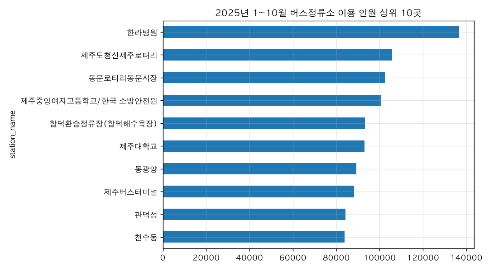

# 제주에서 버스 이용객이 가장 많은 정류소 10곳은 어디야?

## 핵심 답
2025년 1월 1일~10월 25일 기준, 제주에서 버스 이용객이 가장 많은 정류소 10곳은 아래와 같습니다.

| 순위 | 정류소 | 이용 인원(명) |
|---|---|---|
| 1 | 한라병원 | 136,729 |
| 2 | 제주도청신제주로터리 | 105,856 |
| 3 | 동문로터리동문시장 | 102,451 |
| 4 | 제주중앙여자고등학교/한국 소방안전원 | 100,617 |
| 5 | 함덕환승정류장(함덕해수욕장) | 93,169 |
| 6 | 제주대학교 | 93,067 |
| 7 | 동광양 | 89,387 |
| 8 | 제주버스터미널 | 88,214 |
| 9 | 관덕정 | 84,272 |
| 10 | 천수동 | 83,828 |

## 근거
- 자료: 제주빅데이터센터 「이용자 유형별 버스정류소 이용 인원 현황」(정류소·이용자유형별 일별 인원, 2019-01-01~2025-10-25). 해당 기간 자료를 정류소별로 합산해 순위를 냈습니다.
- 같은 기간 이 집계에 등장한 정류소는 2,291곳이고, 정류소당 평균 이용 인원은 7,883명입니다. 1위 한라병원은 평균의 17배가 넘습니다.
- 상위 10곳의 합계는 977,590명으로, 전체 이용 인원 18,059,576명의 5.41%입니다. 10위 천수동도 전체의 0.46% 수준이어서, 이용이 소수 정류소에만 몰려 있지는 않습니다.

## 해석
- 한라병원, 도청·신제주로터리, 동문시장, 제주대, 버스터미널 등 통원·통학·행정·상업 중심지가 상위권을 차지합니다.
- 참고로 2024년 1~12월 자료로 보면 한라병원(168,976명), 제주버스터미널(168,015명), 제주도청신제주로터리(133,310명) 순이었습니다. 2025년 들어 동문시장·제주대 인근이 올라오고 터미널 순위가 내려간 모습이지만, 2025년은 10월 25일까지의 부분 연도라 연간 순위로 단정할 수는 없습니다.

## 더 물어볼 만한 질문
- 이 정류소들의 시간대별(출근·등교 시간) 이용 패턴은?
- 관광객이 많이 쓰는 정류소는 어디인가요?
- 2019년 이후 연도별 1위 정류소는 어떻게 바뀌었나요?

## 차트

## 한계
- 2025년 자료는 1월 1일~10월 25일까지만 제공되어 연간 누적 순위가 아닌 부분 연도 순위입니다.
- 이 자료는 정류소별 '이용 인원'이며 승차·하차를 구분하지 않은 정류소 통과 이용 건수 합계입니다.
- '제주중앙여자고등학교/한국 소방안전원'처럼 두 지점이 한 이름으로 묶여 표기된 경우가 있어 원자료 표기 그대로 집계했습니다.
- 2024년과 2025년 비교는 기간 길이가 달라(12개월 vs 약 10개월) 직접적인 증감 비교로 볼 수 없습니다.
- 정류소 위치·노선 정보는 이 데이터에 없어, 지역별 특성 해석은 일반적 추론 수준입니다.

## 데이터 출처
- 이용자 유형별 버스정류소 이용 인원 현황 — FILE, 이용자유형별버스정류소이용인원현황.csv, 15,803,315행, 불러온 시각 2026-11-10 15:50 (https://jejudatahub.net/data/view/data/743)

## 수치 검증
- ✅ 136,729
- ✅ 105,856
- ✅ 102,451
- ✅ 100,617
- ✅ 93,169
- ✅ 93,067
- ✅ 89,387
- ✅ 88,214
- ✅ 84,272
- ✅ 83,828
- ✅ 2,291
- ✅ 7,883
- ✅ 17
- ✅ 977,590
- ✅ 18,059,576
- ✅ 5.41%
- ✅ 0.46%
- ✅ 168,976
- ✅ 168,015
- ✅ 133,310

_생성: 제주 데이터 길잡이, 2026-11-10 15:52_
