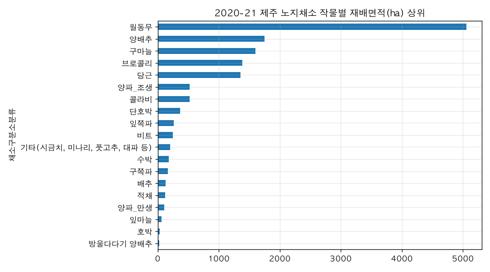
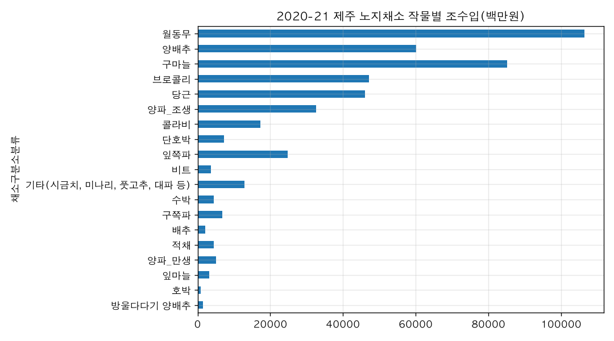

# 제주 노지채소 중 재배 면적이 넓은 작물과 조수입은 어떻게 돼?

## 핵심 답

제주 노지채소(2020-21 시즌, 19개 작물)에서 **재배면적이 가장 넓은 작물은 월동무**이고, **조수입도 월동무가 가장 많습니다.** 다만 1ha당 조수입으로 보면 월동무는 오히려 하위권입니다.

## 근거 (2020-21 시즌, 노지채소 19개 작물)

**재배면적 상위 5**
| 작물 | 면적(ha) | 노지 전체 비중 |
|---|---|---|
| 월동무 | 5,056 | 35.8% |
| 양배추 | 1,753 | 12.4% |
| 구마늘 | 1,600 | 11.3% |
| 브로콜리 | 1,385 | 9.8% |
| 당근 | 1,357 | 9.6% |

노지채소 전체 면적은 14,105ha입니다.

**조수입 상위 5 (백만원)**
| 작물 | 조수입(백만원) | 노지 전체 비중 | 1ha당(백만원) |
|---|---|---|---|
| 월동무 | 106,434 | 22.6% | 21.1 |
| 구마늘 | 85,234 | 18.1% | 53.3 |
| 양배추 | 60,116 | 12.7% | 34.3 |
| 브로콜리 | 47,212 | 10.0% | 34.1 |
| 당근 | 46,108 | 9.8% | 34.0 |

노지채소 전체 조수입은 471,885백만원입니다.

**1ha당 조수입이 높은 작물**: 잎쪽파 95.4, 기타(시금치·미나리 등) 63.7, 양파_조생 62.2, 구마늘 53.3, 방울다다기 양배추 52.8 (백만원/ha)

## 해석

- **면적과 소득의 1위는 같습니다(월동무).** 면적의 3분의 1 이상을 차지하고 조수입의 22.6%를 냅니다.
- 다만 면적 비중(35.8%)보다 조수입 비중(22.6%)이 작습니다. 1ha당 조수입이 21.1백만원으로 19개 작물 중 낮은 편이라, **"넓게 심지만 단위면적 소득은 낮은"** 구조입니다.
- 반대로 **구마늘은 면적 11.3%로 조수입 18.1%**를 내 1ha당 53.3백만원으로 효율이 좋습니다. 잎쪽파(260ha)는 면적은 작지만 1ha당 95.4백만원으로 가장 높습니다.
- 참고로 노지채소 전체 면적은 15-16 시즌 13,949ha → 20-21 14,105ha로 큰 변화가 없지만, 조수입은 540,292 → 471,885백만원으로 줄었습니다(시즌별 가격 변동 영향).

## 더 물어볼 만한 질문

- 작물별 면적·조수입을 6개 시즌 추이로 보여줄까요?
- 월동무 면적은 늘었는데 조수입은 왜 줄었는지 시즌별로 비교해 볼까요?
- 시설채소까지 포함해 전체 채소 순위를 볼까요?

## 차트

## 한계
- 자료는 '제주 채소류 재배 현황'(제주특별자치도, 데이터 기준일 2021-08-09)으로, 가장 최근 시즌이 2020-21입니다. 이후 시즌 변동은 반영되지 않았습니다.
- '연산' 값이 '20-21' 같은 시즌 단위(2020~2021 재배연도)로 집계되어 있어 달력연도 통계와 직접 비교하기 어렵습니다.
- 조수입은 매출 개념(농가 수취 총액)이지 소득·이익이 아닙니다. 생산비를 빼지 않은 값입니다.
- '기타(시금치, 미나리, 풋고추, 대파 등)'는 여러 작물이 묶인 항목이라 1ha당 조수입 비교 시 해석에 주의가 필요합니다.
- 동일 파일에 면적·조수입 결측치가 일부(162/168행 유효) 있어, 결측 작물은 순위 집계에서 빠졌을 수 있습니다.

## 데이터 출처
- 제주 채소류 재배 현황 — FILE, 제주채소류재배현황.csv, 168행, 불러온 시각 2026-11-10 15:52 (https://jejudatahub.net/data/view/data/981)

## 수치 검증
- ✅ 19
- ✅ 19
- ✅ 5,056
- ✅ 35.8%
- ✅ 1,753
- ✅ 12.4%
- ✅ 1,600
- ✅ 11.3%
- ✅ 1,385
- ✅ 9.8%
- ✅ 1,357
- ✅ 9.6%
- ✅ 14,105
- ✅ 106,434
- ✅ 22.6%
- ✅ 21.1
- ✅ 85,234
- ✅ 18.1%
- ✅ 53.3
- ✅ 60,116
- ✅ 12.7%
- ✅ 34.3
- ✅ 47,212
- ✅ 10.0%
- ✅ 34.1
- ✅ 46,108
- ✅ 9.8%
- ✅ 34.0
- ✅ 471,885
- ✅ 95.4
- ✅ 63.7
- ✅ 62.2
- ✅ 53.3
- ✅ 52.8
- ✅ 22.6%
- ✅ 35.8%
- ✅ 22.6%
- ✅ 21.1
- ✅ 19
- ✅ 11.3%
- ✅ 18.1%
- ✅ 53.3
- ✅ 260
- ✅ 95.4
- ✅ 13,949
- ✅ 14,105
- ✅ 540,292
- ✅ 471,885

_생성: 제주 데이터 길잡이, 2026-11-10 15:52_
