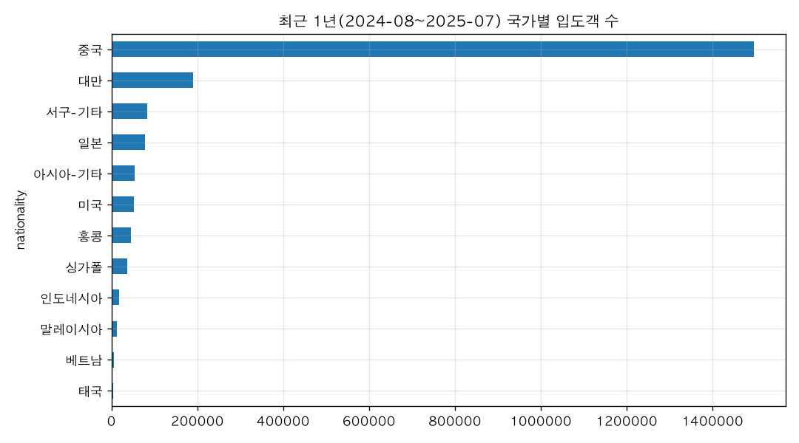
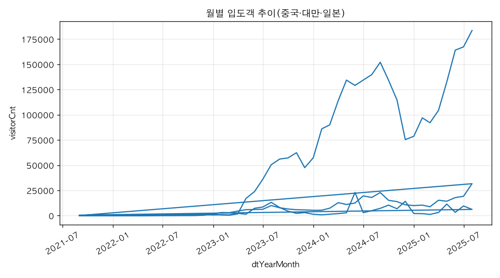

# 외국인 입도객은 어느 나라에서 가장 많이 와?

## 핵심 답: 중국이 압도적으로 1위입니다

제주데이터허브 「국가별 입도객 현황」 자료로 보면, 외국인 입도객이 가장 많은 나라는 **중국**입니다.

**최근 1년(2024년 8월 ~ 2025년 7월) 국가별 입도객**

| 순위 | 국가 | 입도객 수 | 비중 |
|---|---|---|---|
| 1 | 중국 | 1,496,045 | 72.0% |
| 2 | 대만 | 190,231 | 9.2% |
| 3 | 서구-기타 | 82,689 | 4.0% |
| 4 | 일본 | 77,589 | 3.7% |
| 5 | 아시아-기타 | 53,456 | 2.6% |
| 6 | 미국 | 51,793 | 2.5% |
| 7 | 홍콩 | 46,137 | 2.2% |
| 8 | 싱가폴 | 36,124 | 1.7% |
| 9 | 인도네시아 | 18,455 | 0.9% |
| 10 | 말레이시아 | 13,326 | 0.6% |
| 11 | 베트남 | 6,408 | 0.3% |
| 12 | 태국 | 4,932 | 0.2% |

**근거(전체 기간 누적, 2021년 8월 ~ 2025년 7월)** — 순위는 같고 격차는 더 큽니다.
- 중국 2,746,733건(68.7%), 대만 349,688건(8.7%), 서구-기타 179,043건(4.5%), 일본 172,667건(4.3%), 미국 121,743건(3.0%)

## 해석
- 최근 1년 기준 중국이 외국인 입도객 10명 중 약 7명(72.0%)을 차지하고, 2위 대만과도 8배 가까이 차이가 납니다.
- 중국 다음으로는 대만이 확실한 2위이고, 3~6위(서구-기타·일본·아시아-기타·미국)는 5만~8만 명 수준으로 서로 비슷합니다.
- 2021~2022년에는 코로나 영향으로 모든 국가가 수십~수백 건 수준이었고, 2023년부터 급격히 늘어난 흐름이 월별 추이에서 보입니다.

※ '서구-기타', '아시아-기타'는 개별 국가가 아닌 묶음 항목입니다.

## 더 물어볼 만한 질문
- 중국 입도객은 어느 계절에 가장 많이 오나요?
- 대만·일본 입도객은 최근 몇 년간 얼마나 늘었나요?

## 차트

## 한계
- 자료 기간은 2021년 8월~2025년 7월로, 2026년 11월 현재 기준 가장 최근 반년 정도의 입도객은 포함되지 않은 최신이 아닌 자료입니다.
- 국가 구분이 12개 항목(일본, 중국, 홍콩, 대만, 싱가폴, 말레이시아, 인도네시아, 베트남, 태국, 아시아-기타, 미국, 서구-기타)으로 묶여 있어, 그 밖의 국가는 '기타'에 합산되어 개별 순위를 알 수 없습니다.
- 2021~2022년은 코로나19로 입도객이 거의 없던 시기여서, 전체 기간 누적값은 최근 1년 값과 차이가 큽니다.
- 입도객 수는 월별 집계값이며, 환승·경유 여부나 동일인 중복 방문 여부는 데이터에서 구분되지 않습니다.

## 데이터 출처
- 국가별 입도객 현황 — API,  startDate=202108,  endDate=202507, startDate=202108, endDate=202507, 576행, 불러온 시각 2026-11-10 15:52 (https://jejudatahub.net/data/view/data/582)

## 수치 검증
- ✅ 1,496,045
- ✅ 72.0%
- ✅ 190,231
- ✅ 9.2%
- ✅ 82,689
- ✅ 4.0%
- ✅ 77,589
- ✅ 3.7%
- ✅ 53,456
- ✅ 2.6%
- ✅ 51,793
- ✅ 2.5%
- ✅ 46,137
- ✅ 2.2%
- ✅ 36,124
- ✅ 1.7%
- ✅ 18,455
- ✅ 0.9%
- ✅ 13,326
- ✅ 0.6%
- ✅ 6,408
- ✅ 0.3%
- ✅ 4,932
- ✅ 0.2%
- ✅ 2,746,733
- ✅ 68.7%
- ✅ 349,688
- ✅ 8.7%
- ✅ 179,043
- ✅ 4.5%
- ✅ 172,667
- ✅ 4.3%
- ✅ 121,743
- ✅ 3.0%
- ✅ 72.0%
- ✅ 5만
- ✅ 8만

_생성: 제주 데이터 길잡이, 2026-11-10 15:53_
