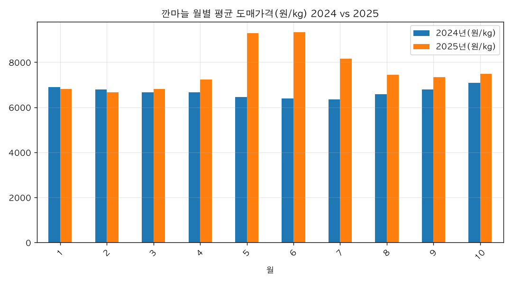
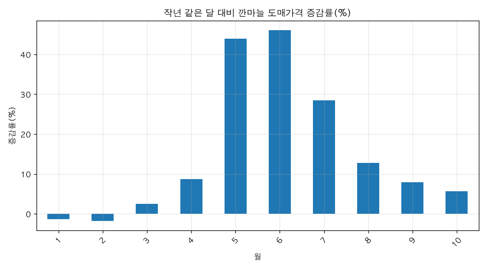

# 요즘 깐마늘 도매 가격이 작년보다 올랐어?

## 핵심 답: 네, 올랐습니다 (1~10월 평균 **+14.8%**)

깐마늘 도매가격은 2025년 1~10월 평균 **7,653.7원/kg**으로, 2024년 같은 기간 **6,664.4원/kg**보다 약 **14.8% 올랐습니다.** 다만 최근 달(10월)만 보면 작년 10월보다 **+5.6%**로 상승 폭이 훨씬 작습니다.

### 근거 (aT도매유통정보시스템, 농산물 품종별 일일 거래 통계)

**연간 동기(1~10월) 비교**

| 구분 | 평균 도매가격(원/kg) | 거래량합계(톤) |
|---|---|---|
| 2024년 1~10월 | 6,664.4 | 58.01 |
| 2025년 1~10월 | 7,653.7 | 82.95 |
| 증감률 | **+14.85%** | — |

**월별 흐름 (작년 같은 달 대비)**

| 월 | 2024년(원/kg) | 2025년(원/kg) | 차이(원/kg) | 증감률(%) |
|---|---|---|---|---|
| 1 | 6,901.2 | 6,807.3 | -93.9 | -1.4 |
| 2 | 6,790.4 | 6,669.2 | -121.2 | -1.8 |
| 3 | 6,654.2 | 6,818.9 | +164.7 | +2.5 |
| 4 | 6,660.6 | 7,239.5 | +578.9 | +8.7 |
| 5 | 6,453.7 | 9,290.9 | +2,837.2 | **+44.0** |
| 6 | 6,387.1 | 9,329.9 | +2,942.8 | **+46.1** |
| 7 | 6,337.9 | 8,144.0 | +1,806.1 | +28.5 |
| 8 | 6,586.9 | 7,429.7 | +842.8 | +12.8 |
| 9 | 6,795.0 | 7,334.0 | +539.0 | +7.9 |
| 10 | 7,076.6 | 7,473.9 | +397.3 | +5.6 |

(차트: 월별 가격 비교 막대그래프, 증감률 막대그래프)

### 해석
- **오름세의 중심은 5~7월**입니다. 작년 5~6월 6,300~6,500원대였던 가격이 2025년에는 9,300원대까지 뛰었습니다(+44~46%).
- 반대로 **1~2월은 작년보다 오히려 조금 낮았습니다**(각 -1.4%, -1.8%).
- 7월 이후로는 상승 폭이 계속 줄어들어 10월에는 **+5.6%**까지 둔화됐습니다. "요즘" 가격만 보면 작년보다 여전히 높지만, 봄에 비하면 오름폭이 크게 줄어든 상태입니다.
- 같은 기간 거래량도 58.0톤 → 83.0톤으로 늘어, 가격 상승이 거래 위축 때문은 아니었던 것으로 보입니다.

### 더 물어볼 만한 질문
- 2025년 11월 이후 가격은 어떻게 됐나요? (이 데이터는 2025-10-31까지)
- 깐마늘 대신 깐양파·당근 등 다른 품목 가격 흐름도 비교해 볼까요?

## 차트

## 한계
- 데이터 기간이 2024-01-02~2025-10-31까지여서, 오늘(2026-11-10) 기준 '요즘' 가격은 포함되지 않습니다. 가장 최근 자료는 2025년 10월입니다.
- '2024년 동기'는 1~10월만 합산·평균한 값으로, 2024년 11~12월은 비교에서 제외했습니다.
- 가격은 aT도매유통정보시스템의 일별 평균 경락가격을 월별로 단순평균한 값으로, 거래일 수·물량 구성이 달마다 달라 단순 비교에는 한계가 있습니다.
- 품목은 '깐마늘' 단일 품종 기준이며, 산지·등급·시장별 구분은 포함되지 않습니다.
- 2021년까지 제공되는 「전국도매시장일별 경락가격」(hub:869)은 기간이 달라 이번 분석에 쓰지 않았습니다.

## 데이터 출처
- 농산물 품종별 일일 거래 통계 — API, startDate=20240101, endDate=20251031, cultivar=깐마늘, 504행, 불러온 시각 2026-11-10 15:53 (https://jejudatahub.net/data/view/data/1361)

## 수치 검증
- ✅ 14.8%
- ✅ 7,653.7
- ✅ 6,664.4
- ✅ 14.8%
- ✅ 5.6%
- ✅ 6,664.4
- ✅ 58.01
- ✅ 7,653.7
- ✅ 82.95
- ✅ 14.85%
- ✅ 6,901.2
- ✅ 6,807.3
- ✅ -93.9
- ✅ -1.4
- ✅ 6,790.4
- ✅ 6,669.2
- ✅ -121.2
- ✅ -1.8
- ✅ 6,654.2
- ✅ 6,818.9
- ✅ 164.7
- ✅ 2.5
- ✅ 6,660.6
- ✅ 7,239.5
- ✅ 578.9
- ✅ 8.7
- ✅ 6,453.7
- ✅ 9,290.9
- ✅ 2,837.2
- ✅ 44.0
- ✅ 6,387.1
- ✅ 9,329.9
- ✅ 2,942.8
- ✅ 46.1
- ✅ 6,337.9
- ✅ 8,144.0
- ✅ 1,806.1
- ✅ 28.5
- ✅ 6,586.9
- ✅ 7,429.7
- ✅ 842.8
- ✅ 12.8
- ✅ 6,795.0
- ✅ 7,334.0
- ✅ 539.0
- ✅ 7.9
- ✅ 7,076.6
- ✅ 7,473.9
- ✅ 397.3
- ✅ 5.6
- ✅ 6,300
- ✅ 6,500
- ✅ 9,300
- ✅ 44
- ✅ 46%
- ✅ -1.4%
- ✅ -1.8%
- ✅ 5.6%
- ✅ 58.0
- ✅ 83.0

_생성: 제주 데이터 길잡이, 2026-11-10 15:53_
