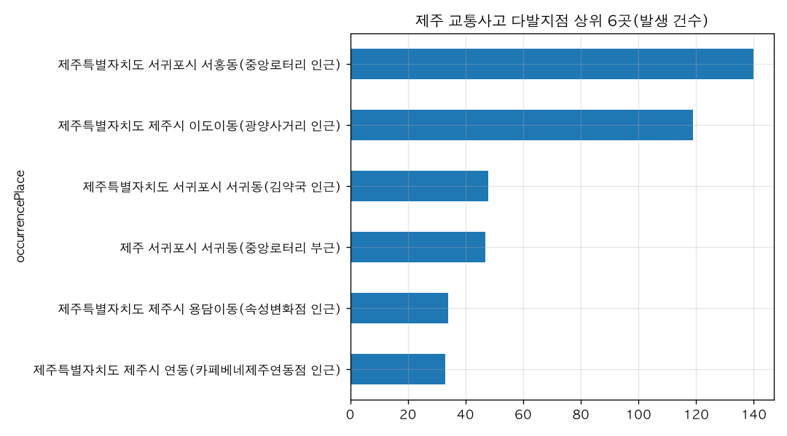
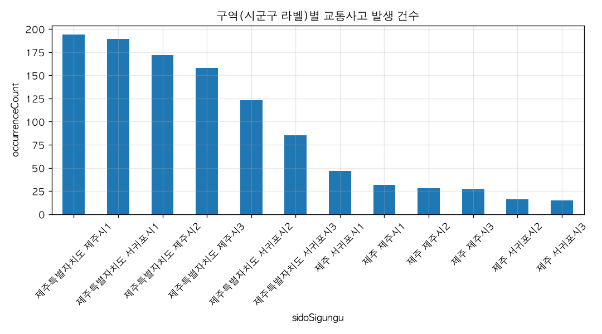

# 제주에서 교통사고가 자주 나는 지역은 어디야?

## 핵심 답
제주 교통사고 다발지점 자료(2017~2023년)에서 가장 사고가 많은 곳은 **서귀포시 서홍동 중앙로터리 인근(140건)** 이고, 두 번째는 **제주시 이도이동 광양사거리 인근(119건)** 입니다. 이 두 곳이 압도적으로 많고, 3위부터는 48건 이하로 크게 줄어듭니다.

## 근거 — 지점 상위 6곳 (다발지점 자료 합산)
| 순위 | 지점 | 발생 건수 | 사상자 수 | 사망자 수 | 중상자 수 |
|---|---|---|---|---|---|
| 1 | 서귀포시 서홍동(중앙로터리 인근) | 140 | 214 | 0 | 46 |
| 2 | 제주시 이도이동(광양사거리 인근) | 119 | 143 | 1 | 28 |
| 3 | 서귀포시 서귀동(김약국 인근) | 48 | 62 | 0 | 17 |
| 4 | 서귀포시 서귀동(중앙로터리 부근) | 47 | 68 | 0 | 8 |
| 5 | 제주시 용담이동(속성변화점 인근) | 34 | 74 | 0 | 0 |
| 6 | 제주시 연동(카페베네제주연동점 인근) | 33 | 39 | 0 | 4 |

## 권역으로 보면
- **제주시 권역**: 다발지점 21곳, 사고 611건, 사상자 851명(사망 3명, 중상 108명)
- **서귀포시 권역**: 다발지점 21곳, 사고 475건, 사상자 674명(사망 2명, 중상 149명)

즉 건수는 제주시 쪽이 더 많지만, **중상자는 서귀포시(149명)** 가 더 많습니다. 서귀포는 중앙로터리·서귀동 일대에 사고가 집중되는 반면, 제주시는 이도이동·용담이동·연동 등 여러 지점에 분산된 모습입니다.

## 더 물어볼 만한 질문
- 서귀포 중앙로터리 인근 사고는 연도별로 늘고 있나요?
- 사망사고가 난 지점은 어디인가요?
- 시간대별·요일별로 사고가 몰리는 때가 있나요?

## 차트

## 한계
- '교통사고 다발지역 정보'(공공데이터포털, 2017~2023년)는 사고가 많은 지점만 추린 목록이라 제주의 모든 교통사고를 포함하지 않습니다. 따라서 '제주에서 가장 위험한 지역'의 전체 순위가 아니라 '다발지점으로 지정된 곳 중 순위'로 해석해야 합니다.
- 자료의 시군구 표기가 '제주시1·2·3', '서귀포시1·2·3'처럼 연도별로 나뉘어 있어 원래의 행정구역 단위 순위는 알 수 없고, 제주시/서귀포시 두 권역으로만 합산했습니다.
- 같은 장소가 '중앙로터리 인근'과 '중앙로타리 부근'처럼 다르게 표기돼 있어 지점별 집계는 실제보다 적게 잡혔을 수 있습니다(서귀동 일대 등). 표기 변형을 합치면 해당 지점 건수는 더 늘어납니다.
- '건수' 열은 그 지점이 다발지점 목록에 몇 번(몇 개 구역·연도) 등장했는지를 뜻하며 사고 건수와는 다른 값입니다.
- 2023년까지만 제공되는 자료로, 최근(2024~2026년) 상황은 반영되지 않았습니다.
- 개별 사고 지점 정보만 있고 교통량·차량 통행량 자료가 없어, 사고가 많은 이유(유동인구·차량 통행량 등)를 이 데이터만으로 설명할 수는 없습니다.

## 데이터 출처
- 교통사고 다발지역 정보 — API, 42행, 불러온 시각 2026-11-10 15:55 (https://jejudatahub.net/data/view/data/863)

## 수치 검증
- ✅ 140
- ✅ 119
- ✅ 48
- ✅ 140
- ✅ 214
- ✅ 46
- ✅ 119
- ✅ 143
- ✅ 28
- ✅ 48
- ✅ 62
- ✅ 17
- ✅ 47
- ✅ 68
- ✅ 34
- ✅ 74
- ✅ 33
- ✅ 39
- ✅ 21
- ✅ 611
- ✅ 851
- ✅ 108
- ✅ 21
- ✅ 475
- ✅ 674
- ✅ 149
- ✅ 149

_생성: 제주 데이터 길잡이, 2026-11-10 15:56_
