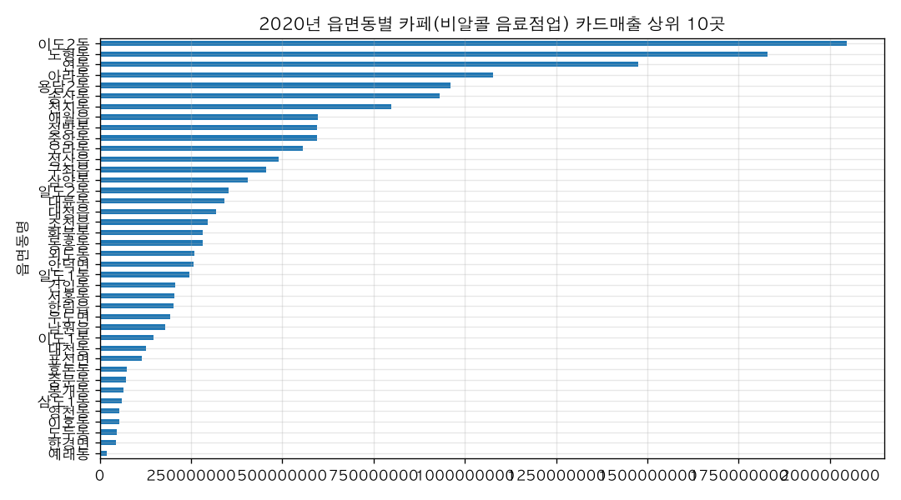

# 애월읍에 카페를 차리면 손님이 많을까?

## 결론: 애월읍 카페는 "손님 수"는 많은 편입니다 (제주 상위권)

**2020년 연간 카페 카드매출 5억 9,706만 원, 이용자 46,217건**으로 제주 43개 읍면동 중 **8위**였고, **2021년 1~5월에는 3억 7,696만 원으로 4위**까지 올라섰습니다. 카페를 차리면 절대 손님이 적은 동네는 아니라는 뜻입니다.

다만 **1인당 결제액은 12,919원**으로, 2020년 매출 상위 10곳 중 가장 낮았습니다. 손님 수는 많지만 객단가(한 명이 쓰는 돈)는 낮은 편입니다.

## 근거

**① 읍면동별 카페 매출 순위 (2020년, 비알콜 음료점업)**

| 순위 | 읍면동 | 카드매출 | 이용자수 |
|---|---|---|---|
| 1 | 이도2동 | 20억 4,607만 | 217,278 |
| 2 | 노형동 | 18억 2,913만 | 209,387 |
| 3 | 연동 | 14억 7,419만 | 151,999 |
| … | … | … | … |
| **8** | **애월읍** | **5억 9,706만** | **46,217** |

**② 2021년 1~5월 애월읍 카페 매출의 손님 구성**

| 구분 | 매출 비중 |
|---|---|
| 개별 관광객 | 45.9% |
| 단체 관광객 | 27.3% |
| 제주 도민 | 26.8% |

→ 관광객 두 갈래를 합치면 도민(26.8%)의 약 **2.7배**입니다. 애월읍 카페는 사실상 관광 수요로 돌아가는 상권입니다.

**③ 유동인구와 매출의 관계**: 애월읍 카페 월매출과 방문인구의 상관계수는 **0.758** (12개월). 방문객이 늘어난 달에 매출도 같이 늘어나는 흐름이 뚜렷합니다.

**④ 계절성**: 2021년 월매출이 1월 4,032만 원 → 5월 1억 38만 원으로 **1월의 2.49배**가 됐습니다. 봄·여름 성수기에 손님이 몰립니다.

## 해석

- 애월읍은 제주 시내(이도2동·노형동·연동) 다음 가는 카페 상권으로, 읍면 지역 중에서는 선두권입니다. "손님이 올까"에 대한 답은 **"온다, 단 관광 성수기에 크게 좌우된다"**입니다.
- 관광객 매출이 도민 매출의 2.7배 구조라 **비 오는 날·겨울 비수기 매출 하락을 견딜 자금 계획**이 중요합니다.
- 1인당 결제액이 12,919원으로 상위 10곳 중 가장 낮다는 점은, 커피 단품 위주보다 디저트·브런치·기념품을 함께 파는 구성이 유리할 수 있다는 신호로 읽힙니다.

## 더 물어볼 만한 질문
- "애월읍 안에서 어느 쪽(애월리·하귀·곽지 등)이 유리한가요?"
- "카페 말고 애월읍에서 매출이 잘 나오는 업종은 무엇인가요?"
- "계절별 매출 차이가 다른 지역보다 큰가요?"

## 차트

## 한계
- 자료 기간이 2020년(월별)과 2021년 1~5월로, 지금(2026년) 기준 최신이 아닙니다. 특히 코로나19 시기라 관광 수요가 평시와 다를 수 있습니다.
- 매출은 카드 결제 기준이라 현금·간편결제 일부는 빠져 있을 수 있습니다.
- '카페'는 업종 분류상 '비알콜 음료점업'으로 잡았으며, 이 분류에 카페 외 음료 판매점이 일부 섞여 있을 수 있습니다.
- 자료의 매장 수 열이 모든 읍면동에 약 600으로 동일하게 채워져 있어(예: 도련이동 615.7, 이호이동 599.9), 애월읍 카페 경쟁 강도(매장 밀도)는 이 자료로 비교할 수 없습니다.
- 분석 단위가 읍면동이라 애월읍 내부의 입지별(해안도로변·하귀 등) 차이는 알 수 없습니다.
- 2021년 순위는 1~5월 5개월만 집계한 값이라 연간 순위와 직접 비교할 수 없습니다.
- 유동인구 값은 '연월별 합계(정각 측정 인구 × 체류시간/60)' 단위여서 '명'으로 환산해 해석하면 안 됩니다.

## 데이터 출처
- 제주특별자치도_주제3_상권분석을 위한 유동인구에 따른 카드 매출액 변화 데이터 활용_매쉬업결과 — FILE, 제주특별자치도_주제3_상권분석을 위한 유동인구에 따른 카드 매출액 변화 데이터 활용_매쉬업결과_20(수정).csv, 26,938행, 불러온 시각 2026-11-10 15:56 (https://jejudatahub.net/data/view/data/748)
- 제주특별자치도_주제1_제주 예비창업자를 위한 업종별 카드 매출과 매장수 데이터 활용_매쉬업 결과 — FILE, 제주특별자치도_주제1_제주 예비창업자를 위한 업종별 카드 매출과 매장수 데이터 활용_매쉬업결과_21.csv, 193,855행, 불러온 시각 2026-11-10 15:56 (https://jejudatahub.net/data/view/data/746)

## 수치 검증
- ✅ 5억 9,706만
- ✅ 3억 7,696만
- ✅ 20억 4,607만
- ✅ 18억 2,913만
- ✅ 14억 7,419만
- ✅ 5억 9,706만
- ✅ 1억 38만
- ✅ 46,217
- ✅ 43
- ✅ 12,919
- ✅ 217,278
- ✅ 209,387
- ✅ 151,999
- ✅ 46,217
- ✅ 45.9%
- ✅ 27.3%
- ✅ 26.8%
- ✅ 26.8%
- ⚠️ 근거 표에서 찾지 못함 2.7
- ✅ 0.758
- ✅ 4,032만
- ✅ 2.49
- ⚠️ 근거 표에서 찾지 못함 2.7
- ✅ 12,919

_생성: 제주 데이터 길잡이, 2026-11-10 15:57_
