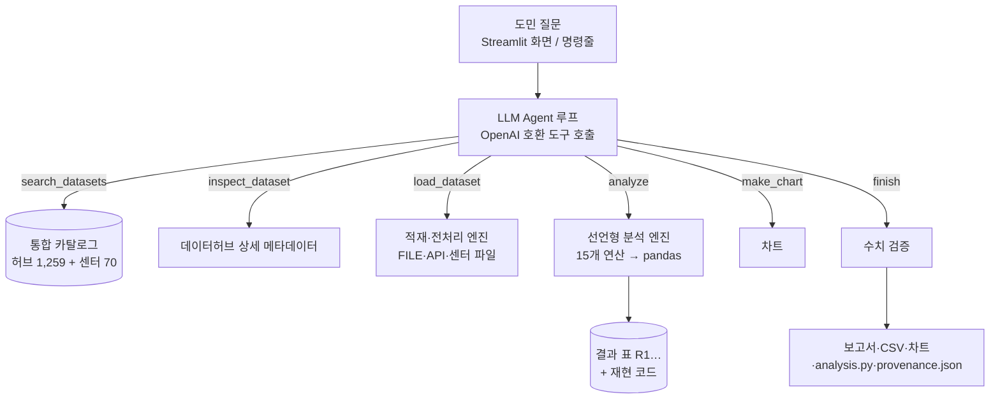

# 결과 설명자료 — 제주 데이터 길잡이

## 1. 문제 정의

| 문제 | 근거 | 해결 방향 |
|---|---|---|
| 데이터를 찾기 어렵다 | 제주데이터허브 1,259종(관광 433·보건 198·교육행정 134 …), 행정 용어 제목, LINK형 517종 | 도민 표현으로 검색되는 통합 카탈로그 + Agent의 재검색 |
| 열어도 분석이 어렵다 | 624MB·1,580만 행 CSV, UTF-8/CP949 혼재, 따옴표 없는 쉼표 행 10만여 개, 통계표의 `-` 표기, API 요청 변수 | 견고한 적재·전처리 엔진 + 선언형 분석 |
| AI 답의 숫자를 믿기 어렵다 | 일반 챗봇은 데이터를 보지 않고 숫자를 생성 | 계산은 엔진이, 숫자는 자동 대조, 과정은 재현 코드로 |
| 센터 데이터는 센터에서만 | 센터 70종 중 다수가 반출 불가 | 센터 PC 폴더를 같은 Agent에 연결 |

## 2. Agent 구조

설계 원칙
- **LLM은 판단, 코드는 계산**: LLM은 데이터 선택과 분석 계획만 정하고, 계산은 결정적 엔진이 합니다. 임의 코드 실행이 없어 센터 PC에서 안전합니다.
- **모든 표에 출처**: 불러온 표(D)와 결과 표(R)는 데이터 ID·파일/요청 변수·분석 단계를 달고 다닙니다.
- **실패해도 멈추지 않기**: 도구 오류는 모델에 그대로 돌려줘 스스로 고치게 하고, 빈 응답·깨진 도구 인자·단계 한도는 루프가 처리합니다.

## 3. 주요 기능

| 기능 | 구현 | 위치 |
|---|---|---|
| 한국어 데이터 검색 | 글자 2-gram BM25, 제목 가중, 동의어 확장, 적재 불가(LINK) 감점 | `catalog.py` |
| 데이터 적재 | FILE 첨부 다운로드·캐시, API 페이지 수집(`number`·`limit`·`hasMore`), 센터 폴더 자동 연결 | `datahub.py`, `datasets.py` |
| 전처리 | 인코딩 판별, 따옴표 없는 쉼표 행 복구, 숫자·날짜 변환, ID·코드 보존, `-` 결측 처리 | `datasets.py` |
| 분석 | filter·select·rename·derive·groupby·resample·pivot·sort·head·share·pct_change·rolling·merge·corr·describe. 증감률은 날짜 기준 바로 앞 기간과만 비교, 비율 이름의 열은 나눗셈으로만 생성 | `ops.py` |
| 차트 | 선·막대·가로막대·원·산점도, 한글 글꼴 자동 | `charts.py` |
| 수치 검증·자기 수정 | 답변 집계 숫자 추출(쉼표·%·만/억·`5억 9,706만`·`40만 4,233` 혼합 표기, ‘228곳’ 같은 개수 포함, 연도·날짜·순위·노선번호·질문 속 조건 숫자 제외) → 결과 표·관측값과 반올림 대조(천·만·백만 단위 열 포함). 근거 없는 숫자가 있으면 finish를 한 번 되돌려 Agent가 계산·삭제로 고침 | `verify.py`, `agent.py` |
| 결과 내보내기 | `report.md`, `R*.csv`, `chart*.png`, `analysis.py`, `provenance.json`, ZIP | `report.py` |
| 화면 | 예시 질문, 실시간 진행 표시, 근거·출처·과정 펼침, 결과 내려받기, AI 없이 쓰는 데이터 찾아보기 | `app.py` |

## 4. 실행 결과

대표 질문을 분야별로 골라 실제로 실행한 결과입니다(제주데이터허브 FILE 데이터 + 프로젝트 키로 연 API 데이터).
원자료: [`scenario_results.json`](scenario_results.json), 답변별 보고서·재현 코드: [`examples/`](examples/).

<!-- SCENARIOS:START -->
모델 `deepseek-ai/deepseek-v4.1-flash-1017` · FILE + API(프로젝트 키) · 완주 8/8

| 분야 | 질문 | Agent가 고른 데이터 | 결과 | 도구(오류) | 수치 검증 | 차트 | 시간 |
|---|---|---|---|---|---|---|---|
| 농업 | 서귀포시 감귤 종류별로 생산량이 어떻게 변해왔어? | 서귀포시 감귤 종류별 면적 및 생산량 추이(연간) | 완료 | 8 (0) | 35/35 | 1 | 36초 |
| 교통 | 제주에서 버스 이용객이 가장 많은 정류소 10곳은 어디야? | 이용자 유형별 버스정류소 이용 인원 현황 | 완료 | 19 (4) | 20/20 | 1 | 93초 |
| 농업 | 제주 노지채소 중 재배 면적이 넓은 작물과 조수입은 어떻게 돼? | 제주 채소류 재배 현황 | 완료 | 10 (0) | 48/48 | 2 | 31초 |
| 관광 | 외국인 입도객은 어느 나라에서 가장 많이 와? | 국가별 입도객 현황 | 완료 | 12 (3) | 37/37 | 2 | 35초 |
| 가격 | 요즘 깐마늘 도매 가격이 작년보다 올랐어? | 농산물 품종별 일일 거래 통계 | 완료 | 11 (1) | 60/60 | 2 | 43초 |
| 생활 | 제주시와 서귀포시에 전기차 충전소가 각각 몇 곳 있어? | 전기자동차 충전소 정보 | 완료 | 22 (1) | 7/7 | 0 | 68초 |
| 안전 | 제주에서 교통사고가 자주 나는 지역은 어디야? | 교통사고 다발지역 정보 | 완료 | 13 (2) | 27/27 | 2 | 62초 |
| 상권 | 애월읍에 카페를 차리면 손님이 많을까? | 제주특별자치도_주제1_제주 예비창업자를 위한 업종별 카드 매출과 매장수 데이터 활용_매쉬업 결과 제주특별자치도_주제3_상권분석을 위한 유동인구에 따른 카드 매출액 변화 데이터 활용_매쉬업결과 | 완료 | 24 (2) | 22/24 | 1 | 102초 |
<!-- SCENARIOS:END -->

답변 집계 숫자 258개 중 256개(99.2%)가 결과 표에서 확인됐습니다(개수 단위 ‘곳·개·건’까지 검증 대상에 넣은 뒤 실측).
남은 2개는 상권 답변의 “관광객 매출이 도민의 약 2.7배”로, Agent가 비율을 표로 계산하지 않고 어림해 화면·보고서에 ⚠️ 경고로 표시됐습니다.
관광(국가별 입도객)·가격(농산물 품종별 일일 거래 통계, 2025년 10월까지)·생활(전기자동차 충전소 정보)·안전(교통사고 다발지역 정보)은
Agent가 API 데이터를 골라 요청 변수(기간·품종)를 직접 채워 불러왔습니다.
생활 질문은 **답변 불가를 정직하게 밝힌 사례**입니다. 충전소 데이터에 시·군을 가를 주소 열이 없어, Agent는 이름·좌표로 지역을 짐작해 세지 않고
전체 충전소 수와 함께 주소가 포함된 데이터가 필요하다고 답했습니다(완주로 집계했지만 질문에 직접 답하지는 못함).

### 로컬 AI(인터넷 AI 키 없이)
센터 PC 사양(GTX 1060 6GB)에 맞춰 `setup_local_ai.bat`으로 `qwen3.5:4b`를 설정하면 키 없이 실행됩니다.
<!-- LOCAL:START -->
같은 대표 질문 8개를 로컬 qwen3.5:4b로 돌린 결과 데이터를 불러와 답한 질문 5/8, 답변 수치 확인율 86.0%, 질문당 중앙값 105초였습니다(Apple Silicon에서 실측, GTX 1060에서는 더 느릴 수 있음).
<!-- LOCAL:END -->
원자료: [`scenario_results_local.json`](scenario_results_local.json). 4B 모델은 관광·안전·상권 질문에서 알맞은 데이터를 찾지 못하거나 적재에 실패했고,
차트를 거의 만들지 않았으며, 표로 계산하지 않은 숫자가 더 많이 남아(경고로 표시) 심사·실사용에는 원격 모델을 권장합니다.

### 사례: 서귀포시 감귤 품종 전환
Agent는 ‘감귤 생산량’ 검색 → ‘서귀포시 감귤 종류별 면적 및 생산량 추이(연간)’ 선택 → 생산량 행만 걸러 연도별 품종 합계 →
2012·2022년 비교와 증감률·구성비 계산 → 추이·구성비 차트를 만들었습니다. 답변의 숫자 수십 개가 모두 결과 표와 일치했고,
노지온주(보통) 항목의 0값을 ‘집계 기준 변경 가능성’으로 한계에 적었습니다.

### 사례: 버스 이용객 많은 정류소
1,580만 행 파일을 불러와 기간을 거르고 정류소별로 합산했습니다. 개발 초기에는 정류소 이름 속 쉼표 때문에 공항 정류소 등
10만여 행이 버려졌는데, 깨진 행 복구를 넣은 뒤 모든 행이 집계됩니다. 같은 장소가 ‘방면’별로 나뉜 이름은 Agent가 스스로
`contains` 필터로 묶어 확인했습니다.

## 5. 검증 방법과 한계

검증
- 단위 테스트(`uv run pytest`, 25개): 분석 엔진이 만든 pandas 코드를 실행해 엔진 결과와 같은지, 날짜 범위 필터, 기간 정렬 증감률(빠진 달 건너뛰지 않기), 비율 이름 열 검사, 코드 열 보존, `-` 결측, 수치 표기 인식(반올림·만/억·혼합 표기·백만원 단위·개수 단위·노선번호·날짜 제외), API 페이지 수집·한도·키 오류, 가짜 LLM으로 돌리는 Agent 루프(근거 없는 숫자 → 1회 자기 수정, 깨진 도구 인자 복구).
- 시나리오 실측(`scripts/run_scenarios.py`): 완주 여부, 도구 오류 뒤 자가 복구, 답변 수치 대조 결과, 소요 시간.
- 수치 검증 실제 사례: 개발 중 모델이 직접 뺄셈한 “8.3만 톤 감소”, “1위와 2위 차이 126,633명”을 근거 없음으로 경고 → finish 단계 자기 수정 루프 추가(근거 없는 숫자를 Agent에 되돌려 analyze로 계산하거나 빼게 함, 1회).
- 심사 기준 자체 점검: 대표 질문 밖의 새 질문 6개(유동인구·한림읍 버스·관광지 증가·월동무 가격·약국·해수욕장 수질)를 새 환경에서 돌려 결과 표와 대조했습니다. 숫자 대조는 통과했지만 뜻이 틀린 사례 — 빠진 달을 건너뛴 ‘전월 대비’, 증감 인원을 ‘증감률’로 부른 열, 기준 미적용 항목을 빼고 쓴 ‘모두 적합’, 이름으로만 고른 지역 정류소 순위 — 를 찾아 엔진 검사(기간 정렬 증감률·비율 열 검사)와 지시문(전체 판단·순위·단위 규칙)으로 막았습니다. 숫자 대조는 값의 출처를 보장하지만 문장의 뜻까지 보장하지 않으므로, 답변의 근거 표를 함께 보여 주고 결과 ZIP으로 재계산할 수 있게 했습니다.

한계
- 데이터허브 다수 자료가 2021~2025년 갱신분이라 최신 현황과 다를 수 있습니다. Agent는 수록 기간을 답에 밝힙니다.
- API 데이터 93종은 사용자 프로젝트 키와 ‘프로젝트 담기’가 필요합니다.
- 데이터 선택·해석의 질은 모델에 따라 달라집니다. 계산과 숫자는 엔진·검증이 지키지만, 더 적합한 데이터를 놓칠 수는 있습니다.
- 수치 검증은 ‘숫자가 결과 표에 있는가’를 봅니다. 숫자의 의미(어느 행의 값인지)까지는 확인하지 않습니다.

## 6. 센터 활용 방안

1. **분석실 PC 기본 도구**: `run.bat` 하나로 설치·실행, 방문 도민이 질문으로 데이터 분석을 시작.
2. **센터 데이터 연결**: 반출 불가 데이터 파일을 `CENTER_DATA_DIR`에 두면 같은 화면에서 분석, 결과(집계)만 반출 절차.
3. **교육 실습**: 결과 ZIP의 `analysis.py`로 “AI가 한 분석을 코드로 다시 해 보기” 실습.
4. **데이터 수요 파악**: `provenance.json`에 쌓이는 질문·선택 데이터로 자주 찾는 데이터, 못 찾은 주제(데이터 공백)를 파악해 개방·정비 우선순위에 반영.
