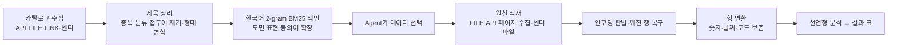

# 데이터 활용 명세

## 1. 필수 데이터(제주데이터허브·제주빅데이터센터)

제주 데이터 길잡이는 특정 데이터 한 종에 묶이지 않고, 질문마다 Agent가 아래 카탈로그에서 데이터를 골라 씁니다.

| 구분 | 출처 | 범위 | 접근 방법 | 이용 조건 |
|---|---|---|---|---|
| 데이터 목록(메타데이터) | 제주데이터허브 `jejudatahub.net/api/data` | 1,259종(API 93·FILE 670·LINK 517, 중복 포함) | 공개 JSON, 키 불필요 | 사이트 공개 정보. 오프라인용 스냅샷 동봉(`resources/catalog_snapshot.json`) |
| FILE 데이터 | 제주데이터허브 데이터 상세의 첨부파일 | CSV·XLSX·JSON 첨부 | 사이트 첨부파일 다운로드와 같은 경로, 키 불필요 | 데이터별 출처 표기(상세 페이지의 ‘출처/제공처’). 원본은 `data/cache`에만 보관하고 재배포하지 않음 |
| API 데이터 | `open.jejudatahub.net/api/proxy/{데이터키}/{프로젝트키}` | 93종 | 사용자 본인 프로젝트 키 + ‘프로젝트 담기’ | 데이터별 일일 호출 한도(1,000~3,000회). 키는 제출물에 포함하지 않음 |
| 센터 방문 데이터 목록 | `jejudatahub.net/api/ndapTable/list` | 70종(경제 32·통신 14·교통 10·기업 8·환경 6), 반출 가능 여부 포함 | 공개 JSON | 목록만 사용. 원천 데이터는 센터 PC에서만 |
| 센터 방문 데이터 원천 | 제주빅데이터센터 분석실 | 센터 제공 CSV/XLSX | 센터 PC의 `CENTER_DATA_DIR` | 반출 불가 데이터는 센터 밖 반출 금지, 결과만 반출 절차 |

### 실제 검증에 사용한 데이터(대표 시나리오)

| 데이터(제주데이터허브 ID) | 형태 | 제공처 | 수집 기간 | 활용 항목 | 활용 질문 |
|---|---|---|---|---|---|
| 서귀포시 감귤 종류별 면적 및 생산량 추이(연간) (1294) | FILE(CSV) | 서귀포시청 | 2012~2022년 수록 | 연도, 읍면동, 구분(농가수·면적·생산량), 품종별 값 | 품종별 생산량·면적 추이, 구성비 |
| 이용자 유형별 버스정류소 이용 인원 현황 (743) | FILE(CSV, 624MB·1,580만 행) | 제주빅데이터센터 | 2019-01-01~2025-10-25 | base_date, station_name, user_type, user_count | 정류소별 이용자 순위(전체·최근 1년) |

시나리오 8종 전체의 사용 데이터·결과는 [결과 설명자료](결과_설명자료.md)와 `docs/scenario_results.json`에 있습니다.

## 2. 수집·전처리

| 단계 | 처리 | 이유 |
|---|---|---|
| 카탈로그 | API·FILE·LINK 목록을 받아 같은 데이터 ID를 한 항목(예: `API+FILE`)으로 병합, `[교통, 안전] [교통, 안전]` 같은 중복 접두어 제거 | 같은 데이터가 두 번 검색되지 않게 |
| 검색 | 제목(가중치 3)·분류·설명의 글자 2-gram BM25. ‘관광객→입도객’, ‘가격→시세’ 등 동의어 확장, LINK형은 점수 절반 | 형태소 분석기·GPU 없이 센터 PC에서 즉시 동작 |
| 인코딩 | 앞 1MB로 UTF-8/CP949 판별, 디코딩 오류 문자는 대체 | 수백 MB 파일을 통째로 디코딩하지 않음 |
| 깨진 행 복구 | 구분자가 따옴표 없이 들어간 행(예: `제주국제공항(대정,화순,일주서로)`)을 정상 행 기준 텍스트 열에 다시 합침. 복구 못 한 행 수는 기록해 답변 한계로 안내 | 버스정류소 파일에서 이런 행 10만여 개(공항 등 핵심 정류소)가 버려지면 순위가 왜곡됨 |
| 형 변환 | 쉼표 숫자 → 수치, 날짜 열(이름에 date·일자 등)의 `YYYYMMDD`·`YYYY-MM-DD` → 날짜. 이름이 ID·코드·번호이거나 앞자리 0이 있는 값은 문자 유지 | API 응답은 전부 문자열. 정류소ID 같은 코드 손상 방지 |
| API 수집 | `number`(페이지)·`limit`로 `hasMore`가 끝날 때까지 수집(서버 한계 페이지당 100행), 상한 2만 행(호출 200회 = 일일 한도 1,000회의 1/5). 상한에 걸리면 “기간을 좁히라”고 Agent에 경고 | 일일 한도·메모리 보호 |

## 3. 분석 흐름

- Agent(LLM)는 코드를 직접 실행하지 않습니다. 분석은 15종 선언형 연산(filter·groupby·resample·pivot·share·pct_change·rolling·merge·corr 등)을 JSON 단계로 지시하고,
  엔진이 pandas로 결정적으로 계산합니다. 각 단계는 같은 결과를 내는 pandas 코드로 함께 기록됩니다(`analysis.py`).
- 결과 표는 `R1, R2…` 핸들로 남고, 답변에 쓴 숫자는 세션의 모든 표·도구가 보여준 메타데이터와 자동 대조됩니다(반올림·만/억 단위·`40만 4,233` 같은 혼합 표기 인식).
- 결과물: `report.md`(답변·차트·한계·출처·수치 검증), `R*.csv`, `chart*.png`, `analysis.py`, `provenance.json`(출처·요청 변수·분석 단계·도구 호출 기록).

## 4. 개인정보·보안

- 사용하는 데이터는 모두 집계 단위 공개 데이터 또는 센터 반출 기준을 따르는 자료이며, Agent 지시문으로 개인 식별 정보는 다루지 않도록 합니다.
- API 키·프로젝트 키는 `.env`에만 두며 화면·보고서·로그·재현 코드에 출력하지 않습니다(재현 코드는 `.env`에서 읽음).
- 제주데이터허브 데이터 목록 엑셀(대회 제공)은 사용하지 않으며 제출물에 포함하지 않습니다.

## 5. 외부 데이터·서비스·오픈소스

| 구분 | 이름 | 용도 | 라이선스/조건 |
|---|---|---|---|
| 외부 데이터 | 없음 | 제주데이터허브·센터 데이터만 사용 | — |
| AI API | OpenAI 호환 Chat Completions(개발·검증: Deploy API `deepseek-ai/deepseek-v4.1-flash-1017`) | 데이터 선택·분석 계획·설명 생성 | 제공사 이용약관. 평가용 키는 제출 ZIP 사용자 매뉴얼 3장에 포함, 평가 후 폐기 |
| 오픈소스 | pandas 3.1.1 | 데이터 처리 | BSD-3-Clause |
| | numpy 2.5.4 | 수치 대조 | BSD-3-Clause |
| | matplotlib 3.11.2 | 차트 | Matplotlib License(PSF 기반) |
| | streamlit 1.67.0 | 웹 화면 | Apache-2.0 |
| | httpx 0.28.1 | HTTP 클라이언트 | BSD-3-Clause |
| | openai 3.48.0 | OpenAI 호환 API 클라이언트 | Apache-2.0 |
| | openpyxl 3.1.5 | XLSX 읽기 | MIT |
| | pyarrow 26.0.1 | pandas 문자열 저장(streamlit 의존성) | Apache-2.0 |
| | pytest 9.2.0 (개발) | 테스트 | MIT |
| 개발 도구 | AI 코딩 도구 | 코드 작성 보조 | — |

전체 의존성과 정확한 버전은 `uv.lock`에 고정되어 있으며 `uv sync --frozen`으로 동일하게 설치됩니다.
